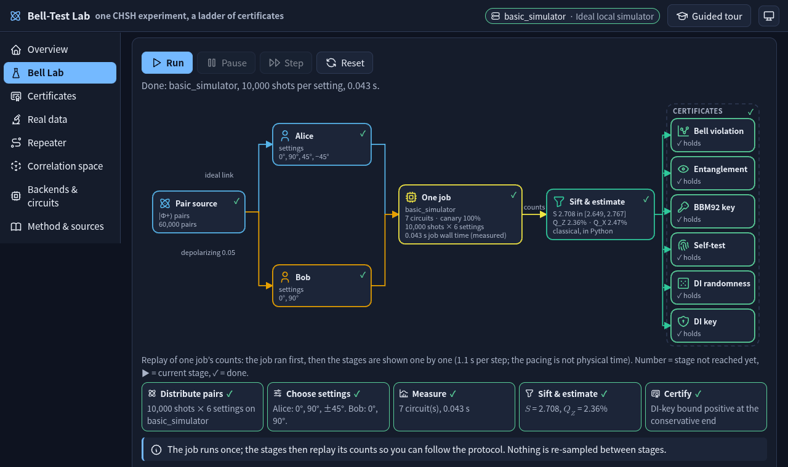
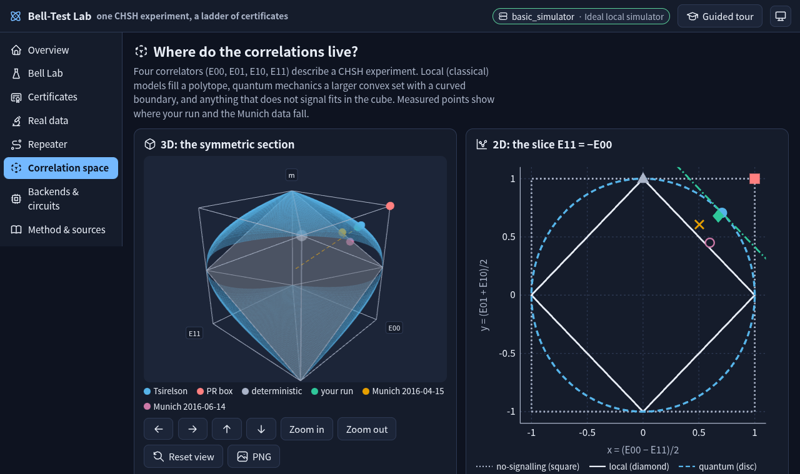
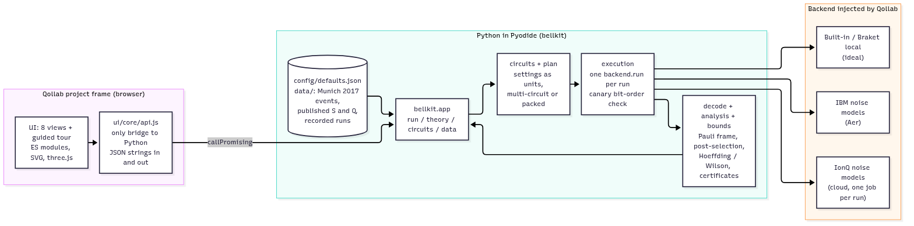
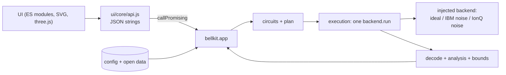
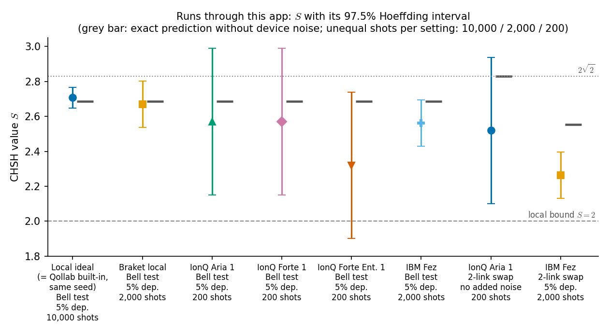
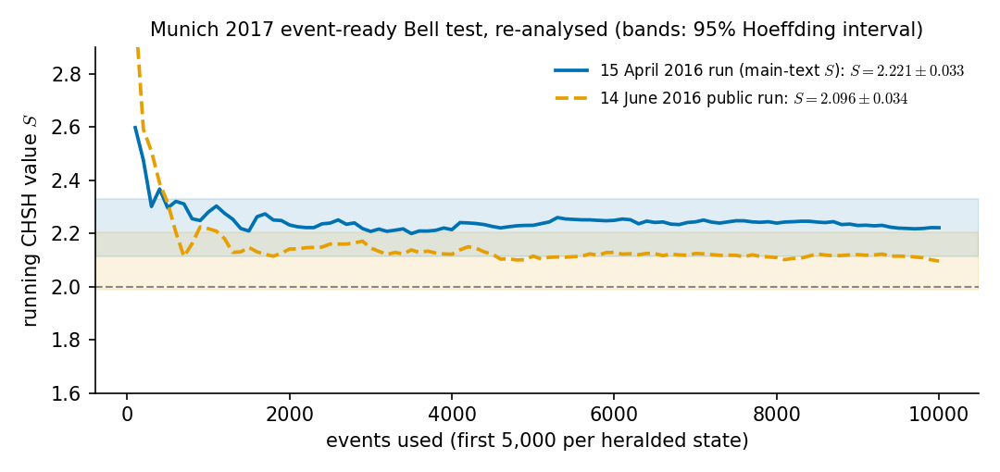
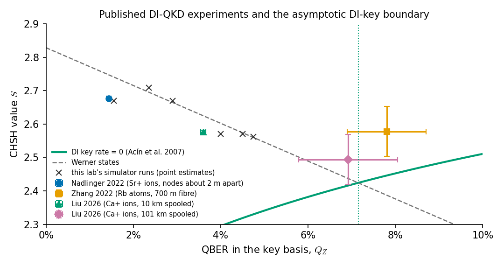

# Bell-Test Lab: one CHSH experiment, a ladder of certificates

An entry for the **Qollab × IonQ Global Quantum Hackathon** — theme **Quantum Unlocked**.

Run a CHSH Bell test on any of Qollab's simulators — ideal, IBM noise models or IonQ noise
models — and see **which claims the same counts support**: "this is not classical", an
entanglement-based key (BBM92), a device-independent key, device-independent randomness, a
self-test. Then add noise or an eavesdropper, stretch the link with entanglement swapping,
try purification, and check the formulas against **open data from a loophole-free Bell test**
and published device-independent QKD experiments.

> Demo video (2:59, YouTube, synthetic narration, English captions): https://youtu.be/6eT2Bk_R-54 · Repository:
> https://github.com/thedaemon-wizard/Qollab_IonQ_Global_Quantum_Hackathon



## Why this lab

Bell tests are usually taught as a yes/no question: is $`S`$ above 2? In practice the same counts
are used for very different claims, and each claim needs different assumptions and a
different amount of evidence:

| Claim | What it assumes about the devices | Threshold (Werner states) |
|---|---|---|
| Bell violation | nothing | $`S > 2`$ |
| Entanglement witness | trusted, calibrated measurements | visibility $`v > 1/2`$ |
| BBM92 key (asymptotic) | trusted qubit measurements | QBER $`Q < 11.0\,\%`$ |
| Self-test, non-trivial (Kaniewski 2016) | nothing; i.i.d. rounds | $`S > 2.106`$ |
| DI randomness (Pironio et al. 2010) | nothing; i.i.d. rounds | $`S > 2`$ |
| DI key (Acín et al. 2007, collective attacks) | nothing; i.i.d. rounds | $`S > 2.424`$, QBER $`Q < 7.15\,\%`$ |

The lab makes this ladder visible. Every run shows each certificate twice: at the **point
estimate**, and at the **conservative end** ($`S`$ at the lower end of its interval, error rates at
the upper ends of theirs; each interval is at 97.5 %, so every claim holds at 95 %). With 10,000
shots per setting most claims survive; with the 200 shots of an IonQ noise-model run, the
device-independent key does not — finite statistics are part of the lesson, not a footnote.

**Terms used here.**

- **CHSH value** $`S`$: a sum of four correlators $`E_{xy}`$; local models give $`\lvert S\rvert \le 2`$,
  quantum mechanics at most $`2\sqrt{2} \approx 2.83`$ (Tsirelson's bound).
- **QBER** ($`Q`$, $`Q_Z`$, $`Q_X`$): quantum bit error rate, the share of rounds in which Alice's and
  Bob's bits differ when both measure in the same basis (Z = key basis, X = the second basis).
- **Werner state**: the entangled pair mixed with white noise, with visibility $`v`$;
  depolarizing noise of strength $`\lambda`$ gives $`v = 1 - \lambda`$.
- **DI (device-independent)**: a claim that needs no model of the devices, only the observed
  statistics. **i.i.d.**: independent and identically distributed rounds (assumed throughout).
- **BBM92**: entanglement-based key distribution with trusted measurements (Bennett, Brassard,
  Mermin 1992). **BBPSSW / DEJMPS**: two entanglement-purification protocols (1996).
- **Pauli frame**: corrections required by a repeater's Bell measurement, applied to Bob's bit
  in software. **TLM**: the Tsirelson–Landau–Masanes test of whether correlators are quantum.
  $`h(x)`$ is the binary entropy.

## What you can do

| View | What it shows |
|---|---|
| **Overview** | The protocol and the software architecture as diagrams; which numbers are simulated, measured or bounds; the injected backend and its run profile; an 8-check formula self-test run in Python at start-up. |
| **Bell Lab** | Choose link noise (depolarizing, dephasing, bit flip, Y flip), an eavesdropper (controlled-Ry with angle $`\varphi`$), an optional YY setting, shots and seed. **One job** runs six settings; the five protocol stages then replay from its counts (Run, Pause, Step, Reset), as a stepper and as a protocol diagram whose current stage lights up and whose boxes fill in with that stage's numbers (the pacing is not physical time). $`S`$ gauge with its interval, outcome counts, correlators against the exact prediction, error rates, the six-rung certificate ladder. Exports to JSON, CSV and PNG. |
| **Certificates** | Key rate against QBER (BBM92 and DI), what $`S`$ alone certifies (min-entropy, von Neumann entropy, self-test bound), noise sweeps for each channel type, and a threshold table — with your latest run placed on the curves. |
| **Real data** | The **Munich 2017 event-ready Bell test** (Rosenfeld et al., open event files) re-analysed with the same estimator; published DI-QKD experiments on the $`S`$–$`Q`$ plane against the DI-key boundary (plus one $`S`$-only result); a distance series (Lu et al. 2026) next to our recomputation. |
| **Repeater** | 1–4 links joined by entanglement swapping (topology diagram, timeline of classical messages, link budget, $`S`$ and QBER against the number of links), and one round of BBPSSW/DEJMPS purification with post-selection. |
| **Correlation space** | A three.js view of the CHSH correlation sets — no-signalling cube, local polytope, curved quantum boundary — with your run, the Munich runs and reference points; plus an exact 2D slice ($`\text{diamond} \subset \text{disc} \subset \text{square}`$) and a membership table for keyboard and screen-reader users. |
| **Backends & circuits** | Every circuit of the run as a diagram with shaded protocol sections, or Qiskit's own text drawing; how the plan is laid out for the backend; transpiled depth and gate counts; a comparison of runs across backends. |
| **Method & sources** | Formulas (MathML), finite-statistics method, limits, disclosure and references. |

A **guided tour** (10 steps, keyboard: Enter/→ next, ← back, Esc close) runs the real circuits:
a perfect pair, an entangled state without violation, an intercept-resend eavesdropper,
realistic noise, the certificate curves, the Munich data, a two-link swap, the correlation
space and the circuits.



## Run it

**On Qollab.** Open the project, press **Run** and pick a simulator in the Run dialog:
*Built-in simulator* or *AWS Braket local simulator* (ideal), any *IBM* noise model, or an
*IonQ* noise model (Aria 1/2, Forte 1, Forte Enterprise 1). Then start the guided tour or
open the Bell Lab. Notes:

- Qollab allows **one IonQ job per project run**. On IonQ the lab packs all six settings into
  one 25-qubit circuit, submits it once, and then disables Run with an explanation; the tour
  only configures experiments there. Press Run in Qollab again for another IonQ experiment.
- The lab **never submits to quantum hardware**: a QPU backend gets a refusal profile.
- Exports (JSON, CSV, PNG) appear in Qollab's **run console**, from where they can be
  downloaded (the project frame itself cannot download files).

**Locally** (Python 3.14):

```bash
python3.14 -m venv .venv && .venv/bin/pip install -r requirements-dev.txt
.venv/bin/python -m pytest -q          # 300+ tests
.venv/bin/python tools/devserver/server.py   # then open the printed URL
```

The local harness serves the same `index.html`/`main.js` and answers the Python calls with
a real simulator (`?backend=basic_simulator` or `?backend=fake_fez`); IonQ needs Qollab.

**Without running anything:** [`notebooks/walkthrough.ipynb`](notebooks/walkthrough.ipynb) is
an executed notebook that calls the same `bellkit` package (one Bell run, the certificate
ladder, a circuit, thresholds, a noise sweep, the swap chain, the Munich data and the packed
IonQ layout). Rebuild it with `.venv/bin/python scripts/make_notebook.py`.

## How it works





- **All physics and statistics are in Python** (`bellkit/`, plain Qiskit + standard library);
  the browser code only draws what it receives. One module, `ui/core/api.js`, calls Python, and
  only with JSON strings. Every default (angles, settings, ranges, run profiles, seed,
  confidence level) lives in `config/defaults.json`; thresholds are computed, not typed in.
- **Run profiles** are chosen from the injected backend's name and class: ideal simulators
  (10,000 shots, one circuit per setting), IBM noise models (2,000 shots, transpiled to the
  device), Braket (2,000 shots, plain gate basis), IonQ (200 shots, **one packed circuit**),
  quantum hardware (refused), anything else (a conservative default, named in the UI).
- **On Qollab, the IonQ simulator accepts one circuit per job** (a job with several circuits
  was rejected when we tested it), so every setting gets its own qubits and classical register in a
  single circuit; the counts keys come back space-separated, last register first. Each job also
  carries a **canary** qubit flipped to 1: if the bit order were ever read wrong, the run stops
  instead of reporting nonsense.
- **No mid-circuit feedback**: IonQ targets do not run dynamic circuits, so the repeaters' Bell
  measurements are deferred to the end and Bob's bit is corrected in software (a **Pauli
  frame**: his Z-basis bit is flipped by the parity of the repeaters' CNOT-target bits, his
  X-basis bit by the parity of their control bits). Purification keeps a round only when the measured second pair agrees
  (post-selection), and reports the measured success probability.

### The physics, briefly

The source prepares $`\lvert\Phi^+\rangle = (\lvert 00\rangle + \lvert 11\rangle)/\sqrt{2}`$. A measurement along
angle $`\theta`$ in the X–Z plane is $`R_y(-\theta)`$ followed by a Z measurement. Alice uses
$`0^\circ`$ (key), $`90^\circ`$, $`\pm 45^\circ`$; Bob uses $`0^\circ`$ and $`90^\circ`$:

```math
S = E_{00}+E_{01}+E_{10}-E_{11},\qquad E_{xy}=\frac{N_\text{same}-N_\text{diff}}{N}.
```

Link noise is an exact **Pauli channel** on Bob's qubit,
$`\rho \mapsto p_I\,\rho + p_X\,X\rho X + p_Y\,Y\rho Y + p_Z\,Z\rho Z`$, built from two ancilla qubits;
depolarizing noise of strength $`\lambda`$ gives the Werner state with visibility $`1 - \lambda`$,
so $`S = 2\sqrt{2}\,(1 - \lambda)`$. The certificates are

```math
r_\text{BBM92}=1-h(Q_Z)-h(Q_X),\qquad r_\text{DI}=1-h(Q)-h\!\left(\tfrac{1+\sqrt{(S/2)^2-1}}{2}\right),
```

```math
H_\text{min}\ge 1-\log_2\!\left(1+\sqrt{2-S^2/4}\right),\qquad F\ge\tfrac12+\tfrac12\,\frac{S-\beta^{\ast}}{2\sqrt2-\beta^{\ast}},\ \ \beta^{\ast}=\tfrac{16+14\sqrt2}{17}.
```

$`S`$ gets a two-sided **Hoeffding** interval and the error rates **Wilson** intervals, with the
risk $`\delta = 0.05`$ split equally between them. A vector of correlators (all $`\lvert E_{xy}\rvert \le 1`$) is
quantum if $`\max_s \sum_{xy} s_{xy} \arcsin E_{xy} \le \pi`$ over the eight sign vectors with
$`s_{00}\,s_{01}\,s_{10}\,s_{11} = -1`$ (Tsirelson–Landau–Masanes), and local if it obeys all eight CHSH
inequalities. Full derivations and page-level sources: [docs/references.md](docs/references.md).

## Results

All runs below were made through this app — on Qollab, except the local reference row — and are stored in
[`data/recorded_runs.json`](data/recorded_runs.json) (the analysis is recomputed from the
captured counts by `scripts/record_runs.py`, with the same code the app runs). The counts were
captured on 2026-10-10 between 00:40 and 03:54 UTC; the circuits and the decoding have not changed
since (later commits changed run gating, input validation and the canary threshold, which every
captured run passes: canary fraction 0.9725 on IBM Fez and 1 elsewhere, threshold 0.75).



| Backend (Qollab) | Experiment | Shots / setting | $`S`$ [97.5 % interval] | Exact prediction | $`Q_Z`$ | DI key rate, point → conservative |
|---|---|---:|---|---:|---:|---|
| Qiskit BasicSimulator (local reference run) | Bell, 5 % depolarizing | 10,000 | 2.708 [2.649, 2.767] | 2.687 | 2.36 % | 0.580 → 0.469 |
| AWS Braket local (ideal) | Bell, 5 % depolarizing | 2,000 | 2.670 [2.538, 2.802] | 2.687 | 1.55 % | 0.566 → 0.343 |
| IBM Fez noise model | Bell, 5 % depolarizing | 2,000 | 2.562 [2.430, 2.694] | 2.687 | 4.75 % | 0.256 → 0.053 |
| IBM Fez noise model | Bell, no added noise | 2,000 | 2.670 [2.538, 2.802] | 2.828 | 2.90 % | 0.492 → 0.265 |
| IonQ Aria 1 noise model | Bell, 5 % depolarizing | 200 | 2.570 [2.151, 2.989] | 2.687 | 4.00 % | 0.300 → none |
| IonQ Forte 1 noise model | Bell, 5 % depolarizing | 200 | 2.570 [2.151, 2.989] | 2.687 | 4.50 % | 0.277 → none |
| IonQ Forte Enterprise 1 noise model | Bell, 5 % depolarizing | 200 | 2.320 [1.901, 2.739] | 2.687 | 10.50 % | none |
| IonQ Aria 1 noise model | 2-link swap, no added noise | 200 | 2.520 [2.101, 2.939] | 2.828 | 2.00 % | 0.339 → none |
| IBM Fez noise model | 2-link swap, 5 % depolarizing | 2,000 | 2.264 [2.132, 2.396] | 2.553 | 9.25 % | none |
| IBM Fez noise model | Bell, Eve at $`\varphi = 180^\circ`$ | 2,000 | 1.322 [1.190, 1.454] | 1.414 | 2.70 % | none ($`Q_X = 51.1\,\%`$) |

The demo video shows one more run, on the IonQ Aria 1 noise model (2026-10-10 23:40 UTC, Bell, 5 %
depolarizing, 200 shots, 22.8 s): $`S = 2.580`$ [2.161, 2.999], $`Q_Z = 3.00\,\%`$, canary 100 %. Its counts
were not exported, so it is not in the table; the values are as shown on screen
(`results/qollab/video_run_20261010.json`).

What the table shows:

- **Device noise adds to the channel noise.** On the noise-model backends $`S`$ falls below the
  channel-only prediction. Within one backend the swap loses more than the Bell test (IBM Fez:
  0.29 against 0.13), since its circuits have more two-qubit gates; the 200-shot IonQ gaps are
  within their intervals.
- **Finite statistics decide the stronger claims.** With 200 shots per setting (IonQ) the
  interval on $`S`$ is about ±0.42. The Aria 1 and Forte 1 runs keep $`S`$ above 2 at the conservative
  end, but the asymptotic DI-key bound turns negative there; the Forte Enterprise 1 run shows a
  Bell violation only at its point estimate ($`S = 2.320`$, lower end 1.901). One 200-shot run per
  model cannot rank the models: its $`S`$ differs from the Forte 1 run's by 0.25, about 1.6 combined
  standard errors. With 2,000–10,000 shots the DI-key bound for the same experiment stays
  positive at the conservative end. (These are simulated counts; see Limits.)
- **The eavesdropper is caught by the second basis**: the key basis looks clean ($`Q_Z \approx 2.7\,\%`$,
  device noise only) while $`Q_X \approx 51\,\%`$ and $`S < 2`$.
- **Reproducibility**: seeded IBM Fez runs on Qollab (Pyodide in the browser) and the same
  requests run locally with Python 3.14 give **identical counts** for all five tour runs.

### Real data: the Munich 2017 loophole-free Bell test



The open event files of Rosenfeld et al. (Phys. Rev. Lett. 119, 010402, 2017; Zenodo
doi:10.5281/zenodo.22936124, CC BY 4.0) list every valid atom–atom event. Mapped onto this
lab's CHSH form, the first 5,000 events per heralded state give **$`S = 2.2213 \pm 0.0332`$** for
the 15 April 2016 run, the paper's 2.221 ± 0.033, and match the paper's published count tables
(Supplement Tables S8 and S10; one cell is kept as a regression test). The public 14 June 2016 run gives 2.0957 ± 0.0340. Under this lab's conservative
i.i.d. Hoeffding bound the April run clears 2 ($`S \ge 2.113`$) and the June run does not
($`S \ge 1.987`$) — the paper's own tests do not assume i.i.d. trials, so this is our reading, not a
contradiction. The data have no key-basis pair, so only CHSH-based certificates apply.

### Published DI-QKD experiments



Quoted $`S`$ and $`Q`$ from Nadlinger 2022, Zhang 2022 and Liu 2026 (10 km and 101 km) are evaluated
with the same asymptotic bounds, at the central values and at the corner $`(S - \sigma, Q + \sigma)`$;
Meiers 2026 (a preprint that makes no device-independent claim) reports $`S`$ only and is listed
without a rate. For Liu 2026 at 101 km the rate is 0.087 at the centre and −0.038 at that
corner. For Lu et al. 2026 (Science 391, 592), our $`(1 - \gamma)\,r_\text{DI}`$ with
$`\gamma = 10^{-3}`$ is 0.0008–0.0015 above every deposited Fig. 5C value; the paper does not print
its exact formula, so the lab reports the difference rather than claiming a reproduction.

## How it was verified

- **More than 300 tests** (`pytest`): every circuit family is checked against the exact channel model
  to $`10^{-9}`$ using exact output distributions (Bell with each channel and the eavesdropper,
  1–3-hop chains with and without the Pauli frame, purification with both rotations, the packed
  IonQ layout); bounds and thresholds against published values; Hoeffding and Wilson
  coverage (by simulation); the correlation-set membership tests (including Monte-Carlo volume ratios $`2/3`$ and
  $`3\pi^2/32`$); the Munich re-analysis against the paper's tables; the published-rate
  recomputation; and static checks of the Qollab rules (no Sampler/Estimator, no dynamic
  circuits, literal data paths, upload limits, a single Python bridge in the browser code).
- **On Qollab**: the full guided tour on the IBM Fez noise model; Bell runs on the built-in
  simulator (same seed and counts as the local reference row: $`S = 2.708`$), Braket, IBM Fez, IonQ Aria 1, IonQ Forte 1 and IonQ Forte Enterprise 1 simulators; a two-link
  swap on IonQ Aria 1.
- Problems found on Qollab and fixed: a module-level name clashing with the injected
  `backend`; the Braket backend's name (`default`) and its loss of circuit names; a 25-qubit
  packed circuit too slow for Braket's state-vector simulator (now one circuit per setting).
  Each is recorded in [docs/decisions.md](docs/decisions.md).

## Accessibility

The terms ask for UI accessibility best practice, so it was tested, not assumed
([results/a11y/](results/a11y/README.md)):

- **Automated**: axe-core 4.14.0 (WCAG 2.0–2.2 A/AA and best practice) reports 0 violations on all
  8 views in the dark and the light scheme; Lighthouse accessibility score 100.
- **Keyboard**: skip link, visible focus, every control reachable; the guided tour works with
  Enter/→/←/Esc and keeps focus while a step runs; the 3D view turns with buttons; sideways
  scroll boxes are focusable.
- **Formulas**: native MathML (Temml, Latin Modern Math), which screen readers read; if the
  formula library cannot load, the same formulas appear as Unicode text. ARIA labels, SVG text
  and status messages stay plain text.
- **Text alternatives**: every chart is an SVG with a title, a description and a data table;
  the 3D view has a 2D slice and a membership table with the same information; points differ by
  shape as well as colour.
- **Display**: contrast checked for every colour token in both schemes; no horizontal page
  scroll at 320 px; the tour fits at 400 % zoom; with reduced motion the replay jumps to the
  result and nothing rotates.
- **Motion**: the Bell Lab's protocol diagram moves only while the replay plays (about 5.5 s);
  Pause stops it and keeps the highlight, and its description states the current stage and its
  numbers, which the stepper list and the status line also give in text.

## What didn't work

- **Several circuits in one IonQ job** were rejected on Qollab, so the six settings share one
  packed 25-qubit circuit with a canary (D4).
- **That packed circuit on Braket's local state-vector simulator** took over 50 s and froze the
  browser tab; Braket now gets one circuit per setting (D9).
- **Mid-circuit feedback** is not available on IonQ targets, so the repeaters' corrections are
  applied in software (Pauli frame) instead of in the circuit.
- **WebGPU** is not exposed inside the project frame, so the 3D view uses WebGL 2 (D10);
  **JupyterLite and PyVista/VTK.wasm** cannot run under the frame's sandbox and file limits
  (D2, D3). **Downloads** from the frame are blocked, so exports go to Qollab's run console.
- **200 shots per setting** (IonQ) are too few for the DI-key bound to survive at the
  conservative end, and on the Forte Enterprise 1 model even the Bell violation did not: the
  IonQ runs here illustrate finite statistics, not a device-independent key.

## Limits — what this lab does not claim

- A simulated CHSH value above 2 shows nothing about nature and closes no loophole.
- Key and randomness numbers are **asymptotic formulas** (collective attacks for the DI key)
  evaluated at finite-sample confidence ends, assuming i.i.d. rounds. They are not finite-size
  or composable security proofs.
- Simulator outcomes come from pseudo-random number generators; nothing here is a QRNG.
- IBM and IonQ noise models are models of devices, not the devices; no quantum hardware was
  used.
- Werner-state thresholds are illustrations: real sources are not Werner states.
- Post-selected purification assumes the keep/discard decision does not depend on the settings.
- Published values are quoted as the authors give them; rates next to them are our
  recomputation and may use a different protocol than the authors'.

## Prior work and what is new here

CHSH simulations, entanglement swapping and DI-QKD rate formulas exist in several public
repositories (some are listed in [docs/references.md](docs/references.md) §7), and Qollab hosts
teleportation and entanglement examples. This lab's contribution is the **teaching design**:
one estimator feeding a ladder of certificates with explicit assumptions; point and
conservative values side by side; the same code applied to open experimental data and to
published experiments; the IonQ one-job constraint handled by a packed, self-checking circuit;
and an accessible interface (keyboard tour, text alternatives for every chart and the 3D view).
In the terms' categories, it is meant as "an original analytical or educational contribution"
(a new way of showing what one Bell test can and cannot certify) and "a technical extension"
(comparative benchmarking across ideal, IBM and IonQ noise-model simulators, with finite
statistics).

The author previously showed an E91/CHSH Werner-state model in a separate public demo
(<https://qsmpc-qkd-qhe-ai-hybrid.daemons.jp/orchestration>, Parameters → QKD protocol
"E91 (CHSH)"); no code from it is used here. The Bell Lab's animated protocol diagram borrows
the idea of the step-by-step flow pages in the author's earlier QKD testbed demo; it was
written new during the window, again with no code reused. During the window the author also
built a second, separate entry, *Entangled Compass* (Quantum Playground: GHZ sensors tracking
real geomagnetic data); the two entries share no code.

## Extending it

- **A new channel**: add a `from_kind` case in `bellkit/channels.py` and its name in
  `config/defaults.json`; the exact-model tests pick it up.
- **A new certificate**: add the formula to `bellkit/bounds.py`, a rung in
  `certificate_ladder`, a row in `ui/views/common.js` (`RUNG_INFO`), and a reference test.
- **A new backend**: add a run profile (match pattern, shots, layout, qubit limit,
  transpilation) to `config/defaults.json`.
- **New open data**: a reader like `bellkit/rosenfeld.py`, a literal path in `bellkit/paths.py`,
  and golden tests against the paper.

## Repository map

| Path | Contents |
|---|---|
| `bellkit/` | Python: channels, circuits and plans, execution, decoding, statistics, bounds, geometry, models, open-data readers, the JSON interface (`app.py`) |
| `ui/`, `index.html`, `main.js`, `main.css` | The interface: core (router, state machine, tour, API bridge, icons), widgets (charts, gauge, circuit and flow diagrams, 3D), eight views |
| `config/defaults.json` | All defaults and run profiles |
| `data/` | Munich event files (CC BY 4.0, with NOTICE), published values, recorded runs |
| `tests/` | Unit, exact-distribution, golden-value and conformance tests |
| `scripts/` | Upload bundle, recorded-run rebuild, README figures, write-up and notebook builders |
| `notebooks/` | Executed walkthrough notebook (repository only) |
| `tools/` | Local harness, icon vendoring, screenshots, environment check |
| `docs/` | References and fact-check notes, design decisions, diagrams and figures |
| `results/` | Captured runs from Qollab and locally, environment check |

## Pre-window material

The build window ran from 2026-10-10 08:00 JST (2026-10-09 23:00 UTC) to 2026-10-12 08:00 JST.
The following existed before it and is disclosed here, as the hackathon terms require.
Everything else was written during the window. The annotated tag `pre-window` marks the
boundary, so `git diff pre-window HEAD` (or `git log --stat pre-window..HEAD`) shows exactly
what was added; GitHub's event log for this repository records the first push of `main`, with
the pre-window commits, at 2026-10-09 10:44 UTC. Commits made in the window are batched
snapshots rather than one commit per change; `e93f76a` ("Apply pre-window audit fixes",
08:56 JST) is in-window corrections to the pre-window text.

| Item | What it is |
|---|---|
| `LICENSE`, `.gitignore`, `pyproject.toml` (ruff/pytest settings) | Repository scaffolding |
| `requirements-dev.txt`, `requirements-dev.lock` | Local Python 3.14 environment (CPython 3.14.7 locally; 3.14.2 in Qollab's Pyodide 314.0.7), pinned to the library versions Qollab's runtime provides (notebook tooling added during the window) |
| `tools/env_check.py`, `results/env_check_20261009.json` | Environment check: library versions, IBM fake backends, IonQ provider construction, one Bell pair on two simulators |
| `docs/references.md` | Literature and software fact-check notes (corrected during the window) |
| `docs/decisions.md` | Design decisions taken before the window, with the evidence behind them (extended during the window) |
| A README skeleton and idea summary | Project plan |
| A throwaway Qollab test project (private draft, 2026-10-09 23:15–23:40 JST; not this entry) | Checked what Qollab's JavaScript runtime allows: static imports, `sendFile`, downloads, three.js and WebGL, and that an IonQ job with several circuits is rejected (see D4). Its probe code is not in this repository and none of it is reused; it was reused once in the window for a WebGPU check (D10). |
| Private design plan (not in this repository): views, module layout, physics model and test plan | Planning notes prepared with generative-AI assistance; no project code |

## Use of AI

Generative-AI coding assistants drafted most of the code, documentation and research notes under
the author's direction; the author set the design, reviewed the changes, ran the tests and checked
the cited sources.
The reviews recorded in [docs/review.md](docs/review.md) were also run with AI assistants; the
author checked each finding before it was fixed.

## Data and third-party material

Munich Bell-test event files: W. Rosenfeld et al., PRL 119, 010402 (2017), Zenodo
doi:10.5281/zenodo.22936124, **CC BY 4.0**. Published values from Lu et al. (Zenodo
doi:10.5281/zenodo.17958512) and Liu et al. (Zenodo doi:10.5281/zenodo.18218281), CC BY 4.0, and
from the cited papers. Tabler Icons (MIT), three.js (MIT, provided by Qollab) and Qiskit (Apache-2.0); loaded at run time
from jsDelivr and not included: Temml 0.14.0 (MIT) and the Latin Modern Math font (GUST Font License). Details: [THIRD_PARTY_NOTICES.md](THIRD_PARTY_NOTICES.md).

## Attribution

This effort is supported by Qollab & IonQ.

## License

[MIT](LICENSE) — Copyright (c) 2026 Amon Koike (Quantum Daemons). The Munich data files in
`data/third_party/` remain under CC BY 4.0 (see their `NOTICE.md`), and values quoted from
papers belong to their authors.
